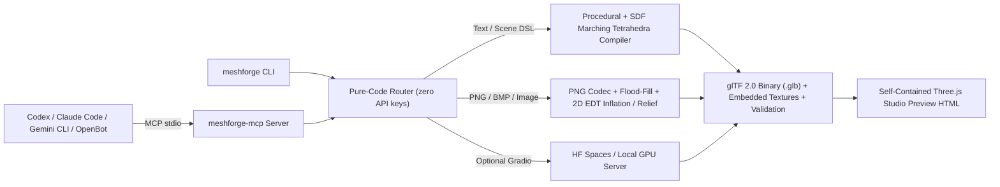

# meshforge-mcp

[](https://glama.ai/mcp/servers/@deusbr/meshforge-mcp)

[](https://github.com/deusbr/meshforge-mcp/actions/workflows/ci.yml)
[](LICENSE)
[](package.json)
[](package.json)

Zero-dependency, **zero-API-key** open-source **Text-to-3D & Image-to-3D** CLI, pure-code procedural/SDF GLB compiler, binary **GLB inspector**, Three.js **studio previewer**, and **Model Context Protocol (MCP)** server for **Codex**, **Claude Code**, **Gemini CLI**, **Claude Desktop**, **Cursor**, **Antigravity**, and **OpenBot**.

Everything runs **100% offline in pure Node.js code** by default — no API keys, no paid credits, no Python/CUDA setup required.

---

## Pure-Code 3D Techniques (Zero API Keys)

| Technique | Engine / Tool | How It Works |
| :--- | :--- | :--- |
| **Image-to-3D Inflation** | `image-inflate` | Pure-JS PNG/BMP decoder (`node:zlib`) → alpha or corner flood-fill segmentation → exact `O(W·H)` Felzenszwalb-Huttenlocher 2D Euclidean Distance Transform → watertight pillow-inflated mesh + embedded UV-mapped PNG texture in `.glb`. |
| **Image-to-3D Relief / Lithophane** | `image-relief` | Luminance extraction + 3×3 Gaussian smoothing → watertight solid heightmap slab with side walls + embedded UV texture in `.glb`. |
| **Declarative Scene DSL + SDF** | `mesh_build_scene` / `build-scene` | Agents (**Codex / Claude Code / Gemini / OpenBot**) compose custom 3D models via JSON parts (`box`, `sphere`, `cylinder`, `cone`, `torus`, `lathe`, `tube`, `extrude`, and `sdf` with `smoothUnion`/`subtract`/`intersect` via Marching Tetrahedra) + PBR materials. |
| **Semantic Text-to-3D Compiler** | `pure-code` | Parses prompt keywords (objects, materials like copper/gold/ceramic/wood, colors, low-poly flags) into multi-part PBR `.glb` meshes in milliseconds. |
| **Optional Neural Engines** | `hunyuan3d-hf`, `sf3d-hf`, `local-gradio` | Optional Gradio 4/5 HTTP+SSE adapters for public ZeroGPU Hugging Face Spaces or a self-hosted local GPU server (`MESHFORGE_LOCAL_URL`). |

---

## Architecture



---

## Quick Start

### 1. Register `meshforge-mcp` in Codex, Claude Code, Gemini CLI, Claude Desktop & Cursor

```bash
node bin/meshforge.cjs install --clients codex,claude-code,gemini,claude-desktop,cursor
node bin/meshforge.cjs status
```

### 2. Generate 3D `.glb` Models Purely by Code (Offline, Zero API Key)

```bash
# Text-to-3D (procedural multi-part PBR)
node bin/meshforge.cjs generate --prompt "copper studio headphones" --out ./out

# Image-to-3D (Teddy / EDT silhouette inflation with embedded UV texture)
node bin/meshforge.cjs generate --image ./logo.png --provider image-inflate --out ./out

# Image-to-3D (solid Gaussian-smoothed luminance relief / lithophane)
node bin/meshforge.cjs generate --image ./photo.png --provider image-relief --out ./out

# Custom Scene DSL JSON (primitives, lathe, tube, extrude, smooth-boolean SDF)
node bin/meshforge.cjs build-scene ./scene.json --out ./out
```

### 3. Inspect or Preview Any `.glb`

```bash
node bin/meshforge.cjs inspect ./out/model.glb
node bin/meshforge.cjs preview ./out/model.glb --out ./out/preview.html
node bin/meshforge.cjs doctor
```

---

## MCP Tools

- `mesh_list_providers` — list local pure-code engines and optional Gradio adapters.
- `mesh_generate_3d` — generate a `.glb` from `prompt` or `imagePath`/`imageUrl` offline in pure code (or optional Gradio), validate geometry, and emit a Three.js HTML preview.
- `mesh_build_scene` — compile any custom Scene DSL JSON (including smooth-boolean SDF Marching Tetrahedra + lathe/tube/extrude + PBR materials) into a validated `.glb` with zero API keys.
- `mesh_inspect_glb` — parse glTF 2.0 binary headers/chunks and report meshes, vertices, triangles, materials, textures, and bounding box.
- `mesh_preview_html` — create a standalone Three.js interactive studio HTML viewer for any local `.glb`.
- `mesh_install_clients` — inspect or atomically register `meshforge-mcp` into Codex, Claude Code, Claude Desktop, Gemini CLI, Cursor, and Antigravity.
- `mesh_doctor` — verify local pure-code capabilities, optional Gradio endpoint reachability, and client registrations.

---

## Verification

```bash
npm run check
npm test
```

## License

[MIT](LICENSE) — Emerson Almeida (`@deusbr`)
